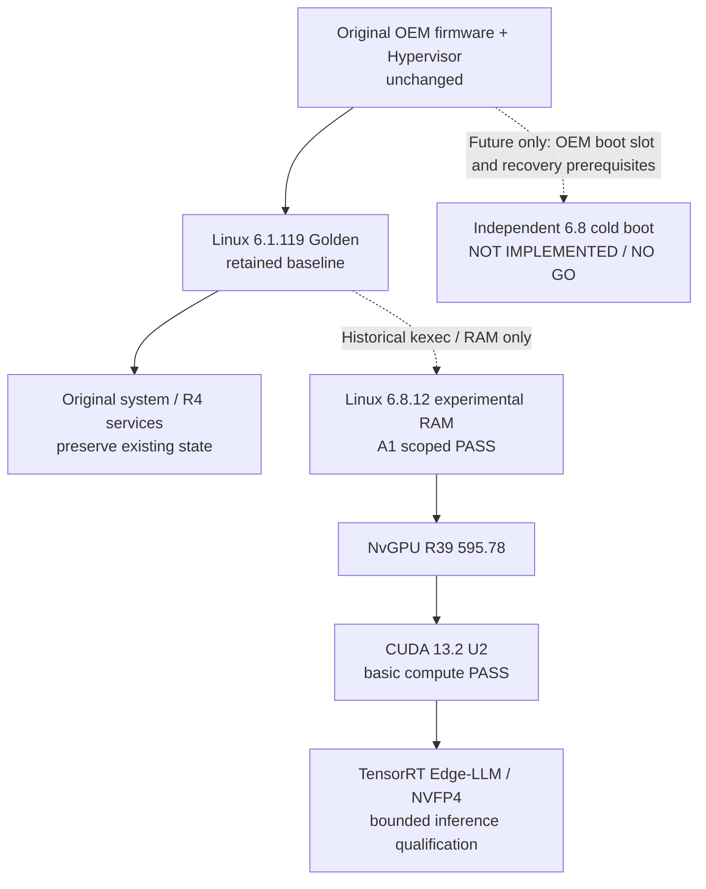

# Thor-U Edge AI Enablement

**Linux Kernel 6.8.12 · NVIDIA R39 NvGPU 595.78 · CUDA 13.2 Update 2 · TensorRT Edge-LLM / NVFP4 / Tree-MTP**

An independent engineering research archive for NVIDIA DRIVE Thor T264 (AArch64, 14 SM, 64GB unified memory). It documents the experimental GPU bring-up, kernel/driver ABI work, native CUDA validation, and LLM inference optimization path.

> IMPORTANT: Not an official NVIDIA platform release. No claim of a qualified cold boot, production-grade Edge-LLM deployment, or official DRIVE SDK certification.

**Dual-path goal:** retain the original DriveOS 7.0.3 / Linux **6.1.119** Golden and add Linux **6.8.12** for native NVIDIA inference. Only the historical 6.1 -> 6.8 **kexec RAM handoff** has been demonstrated. **An independent persistent 6.8 boot item or boot menu is NOT installed.**

## Source provenance / 本机来源地址与公开代码的关系

本项目引用的三个本机研发目录并不是三套公开 Git 仓库。现已提供**[完整 SOURCE_MAP · D/E 来源目录与 GitHub 对应表](docs/SOURCE_MAP.md)**，包含官方 NVIDIA / Hugging Face 来源、逐文件 SHA256 和尚未公开的依赖。可直接查看 [110 行逐文件映射](manifest/SOURCE_MAP_FILES.tsv) 与 [来源统计 JSON](manifest/SOURCE_MAP.json)，并运行 python3 tools/check_source_map.py 作离线核对。

**注意：**106 个映射文件来自这三个目录，另外 4 个来自历史 G5/Golden。4 份 Edge 状态源文件在原始归档之后又发生了变化，仓库保留的是当时冻结版本。

## Complete end-to-end engineering workflow / 全流程总方案

**[Start Here · 全部安装/编译/验收入口](docs/START_HERE.md)** · **[13 阶段执行总控 P00–P12](docs/MASTER_IMPLEMENTATION_PLAN.md)** · **[执行 Checklist](docs/EXECUTION_CHECKLIST.md)**

核心闭环：保留 OEM 6.1 Golden → 6.8.12 精确构建、IVC/vblk/kexec → NVIDIA R39 NvGPU 595.78/CUDA 13.2 U2 → TensorRT Edge-LLM 0.11.0 NVFP4 27B → 完整质量/性能/稳定/恢复验收。

| 专项 | 完整指南 |
|---|---|
| 实际 6.1/6.8 启动模式与第二永久启动项阻断 | [Boot + Cold/Recovery Gates](docs/BOOT_6_1_TO_6_8.md) |
| 完整源码、官方输入和资源锁 | [Assets & Exact Versions](docs/ASSET_AND_VERSION_LOCK.md) |
| 从 Kernel 6.8 到 NVIDIA GPU/CUDA | [Kernel/GPU/CUDA Build](docs/BUILD_KERNEL_GPU_CUDA.md) |
| NVFP4 27B Target/Draft + K7/Tree | [Edge-LLM Native 27B](docs/EDGE_LLM_27B.md) |
| 不同车机/主机部署路线 | [Deployment Runbook](docs/DEPLOYMENT_RUNBOOK.md) |
| 质量/性能/温度/Release Gate | [Acceptance & Release](docs/ACCEPTANCE_AND_RELEASE.md) |
| 故障分层、回滚与恢复 | [Recovery & Troubleshooting](docs/RECOVERY_AND_TROUBLESHOOTING.md) |
| 后续 Codex 协同和资料路径 | [Project Handoff](docs/PROJECT_HANDOFF_AND_PROVENANCE.md) |

Offline-only test: python3 tools/verify_manifest.py && python3 tools/check_repo_release.py. The boot/program readiness tools correctly return **HOLD (code 2)**, so there is **no permanent independent 6.8 boot installation yet**.

## Boot architecture: current evidence vs proposed second boot

**Important:** This is not a conventional PC GRUB/EFI dual boot and the two kernels do not run at the same time. The dotted RAM path is historical; the new boot selection path remains unimplemented. [Detailed diagrams](docs/ARCHITECTURE.md) · [6.1 + 6.8 implementation gates](docs/BOOT_6_1_TO_6_8.md) · [installation guide](docs/INSTALL_ON_THOR.md).

## Current evidence, not marketing

| Layer | Evidence-based outcome | Remaining boundary |
|---|---|---|
| Original 6.1.119 / DriveOS 7.0.3 | Golden system historically captured; original boot assets not overwritten in A1 | Second permanent boot entry / universal auto-recovery NOT proven |
| Linux 6.8.12 / R39 | A1 RAM-booted kernel with NvGPU 595.78 loaded | Standalone cold boot NOT PROVEN |
| CUDA 13.2 U2 | Context, device memory, copy, kernel launch and result verification PASS in A1 session | Does not certify all CUDA APIs or long-term stability |
| TensorRT Edge-LLM | 27B NVFP4 / 8K native inference verified for bounded fixtures | Full quality, independent recovery, production release NO-GO |
| Tree-MTP | 8K cache-bypass sample 57.278 tok/s; K7 frozen comparison 55.444 tok/s | Non-simultaneous, different cache conditions; no broad speedup claim |
| 200K experimental | Limited recall-ID checks and native profiler evidence | Quality / sustained performance / production pending |

Source records date: 2026-10-13 to 2026-10-15. These are snapshots, NOT assertions about the device's present active services.

## What is in this repository?

- docs/ARCHITECTURE.md: architectural Mermaid diagrams with actual 6.1 / experimental 6.8 / Edge-LLM flow
- docs/BOOT_6_1_TO_6_8.md: preserve OEM 6.1 while designing an independent 6.8 add-on and recovery gates
- manifest/BOOT_6_1_TO_6_8_GATES.json + tools/check_dual_boot_readiness.py: offline HOLD/NO-GO assessment; never activates a kernel
- docs/kernel/: build reports, ABI and cold-boot handoff history
- src/kernel-gpu/: authored build, ABI audit and numeric validation helpers
- patches/kernel/: captured kernel config deltas, not an installation patch set
- src/edge-llm/: host-specific Edge-LLM research scripts and diagnostic logic
- evidence/: curated, reduced source-linked original research evidence
- manifest/: source provenance, SHA-256, redaction and exclusions
- docs/INSTALL_ON_THOR.md: safe onboarding and installation boundaries
- tools/preflight_thor_readonly.sh: zero-change target inspection
- tools/verify_manifest.py: offline file-integrity check

## What is NOT included?

No model weights (.safetensors/.gguf), TensorRT engines, firmware, NVIDIA redistributable packages, proprietary driver source trees, API credentials, database snapshots, WSL virtual disks, or active deployment secrets. Their versions and hashes may be referenced as technical evidence.

Some source snapshots had private LAN IP literals replaced with RFC5737 documentation IPs (192.0.2.x). These files are tagged in manifest/SOURCE_FILES.json. They are **NOT drop-in executable deployment artifacts**; operators must provide qualified target configuration and review them.

Files derived from NVIDIA-copyrighted sources have been held back for explicit license and attribution review. This snapshot is a private research work-in-progress, not a self-contained kernel or driver build.

## Start here

1. Read docs/ARCHITECTURE.md and docs/BOOT_6_1_TO_6_8.md: the original 6.1 Golden must remain intact; permanent 6.8 is NOT IMPLEMENTED.
2. Run python tools/check_dual_boot_readiness.py **on a developer PC**. Expected result: HOLD with exit code 2; this never accesses the vehicle.
3. Read docs/STATUS_AND_ACCEPTANCE.md and docs/RESOURCE_BUDGET.md.
4. On an already-qualified target, read docs/INSTALL_ON_THOR.md, then execute only tools/preflight_thor_readonly.sh.
5. On a developer workstation, run python tools/verify_manifest.py. This does not access the vehicle.
6. Do not run old source build / flash / kernel activation scripts just because they are archived.

Official references:
- https://nvidia.github.io/TensorRT-Edge-LLM/0.11.0/user_guide/getting_started/installation.html
- https://github.com/NVIDIA/TensorRT-Edge-LLM
- https://developer.nvidia.com/drive/downloads

**Publication policy:** this is a public research archive with mixed-origin materials, not a universal open-source license or official NVIDIA software distribution. Original NVIDIA/OEM restricted binaries, keys, model weights and complete device firmware remain excluded. Review [release/rights boundaries](docs/RELEASE_AND_SECURITY.md).
