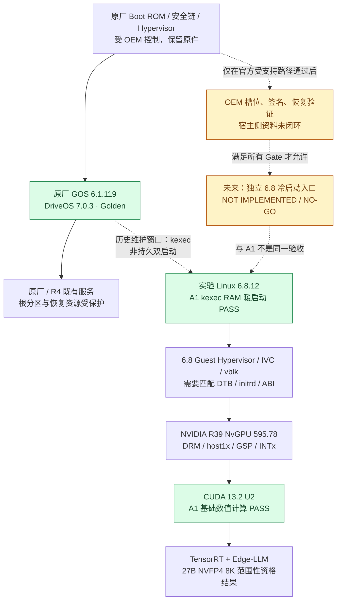
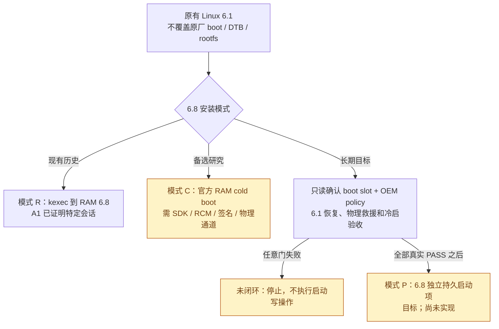
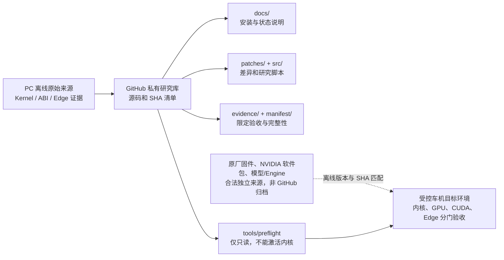

# Thor-U 架构图：6.1 Golden + 6.8 实验内核 + NVIDIA Edge AI

> 读图规则：**实线表示已经出现过的功能链路或已知组件依赖；虚线表示历史条件执行/未来设想**。PASS 只能用于限定的历史实测。不要把图中“目标路径”理解为已经配置完成的双启动系统。

## 1. 引导与运行时分层

**状态解释：**6.1 Golden 的历史只读取证与 A1 6.8 RAM 会话均已存在；但“可选择的第二个 6.8 永久启动项”从未成功安装或验收。历史断电回到 6.1 的证据不等于未来任何系统状态下都能自动回退。

## 2. 从 6.1 新增 6.8 的两条路径（不可混称）

- **模式 R (RAM kexec)：**两个内核不会同时运行；6.8 被当前 6.1 交接进入 RAM，未新增永久启动项。kexec 是一次状态转移，不能假定任何重新启动都回到 6.1。
- **模式 C (cold RAM)：**与模式 R 不同；需要 OEM 支持的主机侧 RAM 加载流程。历史公共 RCM USB 物理传输面不可达，不得宣称本机已有此功能。
- **模式 P (独立持久)：**必须先用官方/获授权工具确认真实启动链和可用的独立装载入口（不假定 EFI、GRUB 或可见 A/B Guest 槽位），再设计非覆盖的 6.8 自有镜像位置与启动选择/回滚。当前是设计目标，代码仓库不包含可执行安装器。

## 3. GitHub 工程结构

## 4. 决策与取证边界

| 条件 | 现状 | 允许行为 |
|---|---|---|
| 6.1 Golden 原厂内核/只读分区 | 历史取证 PASS | 只读对比，不覆盖 |
| 6.1 -> 6.8 RAM kexec | A1 历史 PASS（限具体会话） | 记录证据；不得从文档自动重做 |
| R39 GPU + CUDA 13.2 | A1 基础计算 PASS | 仅在隔离维护窗口做后续资格化 |
| RCM 冷 RAM | 公共 RCM 传输面 FAIL；官方工具依赖未闭环 | NO GO |
| 6.8 独立持久启动与菜单 | NOT IMPLEMENTED | NO GO，禁止猜测槽位和写入 |
| Kernel 6.8 + Edge-LLM 生产切换 | 完整质量和冷启动仍 NO GO | 保留现有生产环境 |

技术方案、门槛和回退依赖见 [BOOT_6_1_TO_6_8.md](BOOT_6_1_TO_6_8.md)；用户操作路径见 [INSTALL_ON_THOR.md](INSTALL_ON_THOR.md)。
