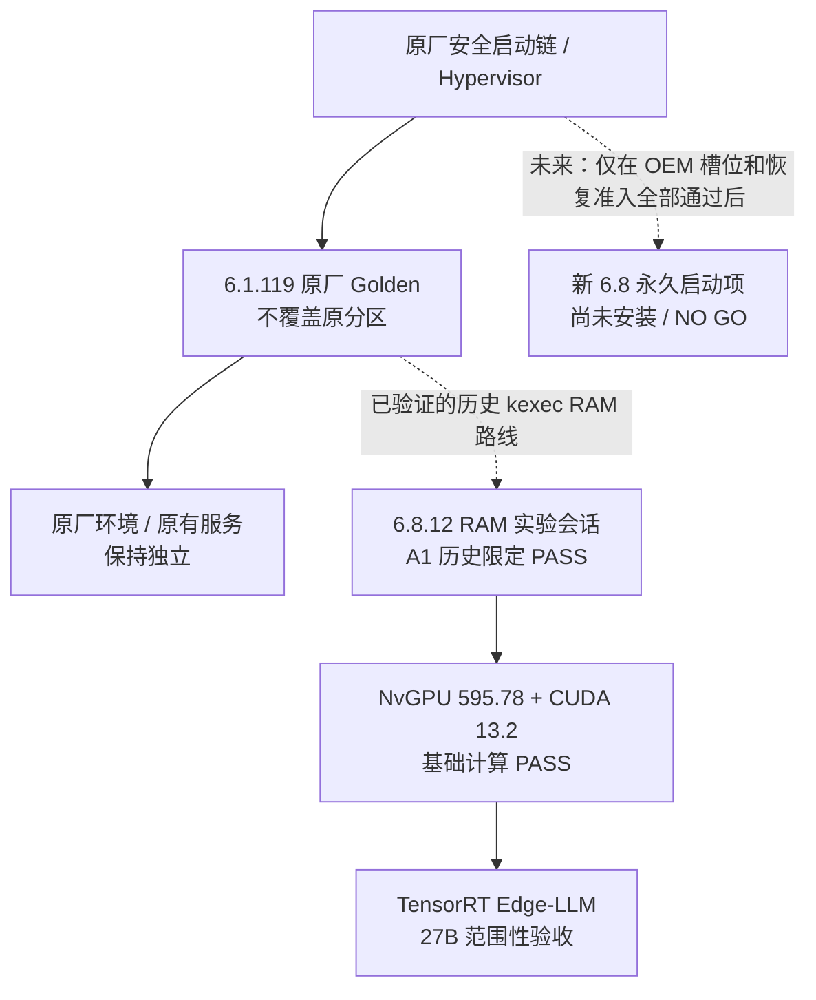

# 安装指南：Thor-U Kernel 6.8 + NVIDIA GPU + Edge-LLM

**状态：安装资料/源码归档已准备；不是可在任何 DriveOS 设备上直接运行的一键刷机包。**

必须分清两个目标：
A. 在已经完成 6.8 A1 RAM 启动和 CUDA 13.2 验证的现有车机上，部署 GitHub 项目资料并只读验收；
B. **保留原始 6.1，再新增独立 6.8**：真正可选的永久双路径启动仍未实现。要先通过 OEM/Hypervisor 启动入口、签名、回退和实机冷启动 Gate；仓库不提供可直接执行的安装/刷写器。

## 结构图：保留 6.1 + 独立增加 6.8 的目标

原厂 GOS 是受 OEM/Hypervisor 控制的 Guest，不得假设它有可自由修改的 GRUB/UEFI 菜单。**kexec 是暖启动内存交接，不是完成双系统安装。**见 [完整系统结构图](ARCHITECTURE.md) 和 [6.1→6.8 增量启动设计](BOOT_6_1_TO_6_8.md)。

## 0. 先确认本机与先决条件

- 目标硬件：NVIDIA DRIVE Thor T264、AArch64、14 SM、64GB UMA。其它 Thor 开发板不自动兼容。
- 历史实验环境：DriveOS 7.0.3 原设备；Linux 6.8.12 RAM 引导；NvGPU 595.78；CUDA 13.2 Update2；TensorRT 10.16.x；Edge-LLM 0.11.0 实验组件。
- 物理/救援：可用的串口、可靠网络回退、原厂 Golden、固定 boot_id 记录、分区/固件清单，且没有正在运行的生产推理请求。
- 资源：MemAvailable >=5 GiB、GPU pool >=2 GiB、Tj <95 C、目标持久卷空闲 >=12 GiB；有 Engine 构建任务则须另留几十 GiB。
- 默认不影响 R4 生产实例、原 DriveOS、Golden、固件/引导槽和安全关键服务。

## 1. 已经有合格 Kernel 6.8 的设备：只读预检

安全命令（不会加载 GPU、构建模型、重启或更改系统）：

~~~sh
uname -m
uname -r
cat /proc/sys/kernel/random/boot_id
grep -E 'MemTotal|MemAvailable' /proc/meminfo
df -h /zeekr_data /zeekr_map 2>/dev/null
cat /etc/os-release | head -6
command -v nvcc || true
~~~

先核对当前系统身份和维护窗口。**不要因为这些检查返回成功就触发 nvidia-smi 或 kexec**：驱动初始化与内核引导必须另有明确的测试资格。

如果私有仓库已创建且可访问，只把 Git 项目复制进一个新的持久目录（不装驱动/不改生产）：

~~~sh
# 先确保目标路径不存在、空间和权限符合操作规范
git clone git@github.com:1989xurui/thor-u-edge-ai-enablement.git \
    /zeekr_data/thor-u-edge-ai-enablement-src
cd /zeekr_data/thor-u-edge-ai-enablement-src
python3 tools/verify_manifest.py
bash tools/preflight_thor_readonly.sh
~~~

私有仓库可通过只读 deploy key 访问。示例假定 git/python3 已安装。上面只安装“源码和说明文件”，**不会安装 Linux Kernel、NVIDIA 驱动、TensorRT Engine 或 27B 模型**。

如果当前系统没有 git、Python 或写入持久空间的授权，先在开发电脑执行 clone、校验，并用已有经过验收的文件分发机制将归档拷到车机。不要对只读原厂根文件系统执行 apt 安装。

## 2. 在现有受控 A1 Linux 6.8 环境上使能推理

以下每一项都是资格门槛，不是自动执行命令：
1. 使用之前冻结的 6.8.12 kernel config 和 ABI/CRC 验收材料核对当前运行对象；不得用历史 G5 失败状态覆盖最新 A1 通过的基础计算，也不得将 A1 通过扩称冷启动通过。
2. 核对官方版本 NvGPU 595.78、完整 DRM/host1x 依赖、固件路径、INTx 中断回退及从源资产逐项验证的 SHA。仓库不分发任何 NVIDIA 驱动/固件包。
3. 在隔离维护会话中使用同版 CUDA 13.2.86 运行已冻结基础数值烟测；正常请求过程中不要强制 GPU 重新初始化。
4. 核对 TensorRT 的实际动态库版本/SONAME、安装版 Edge-LLM wheel 与源码 revision、插件 ABI、SM110 适配；不能仅用 import 成功替代 runtime.load/完整模型推理。
5. 使用已合法取得、SHA 相同的原始 NVFP4 27B 权重与原 Engine；若需要重新构建，单独隔离部署并先算清存储、UMA、编译资源和回退。
6. 先执行 8K、C1、单请求和完全相同的固定输出 ID 验收；然后再评价 Tree-MTP、长上下文、热缓存和持久部署。失败即退回冻结 K7 或 Golden。
7. 不将本仓库内 src/ 中带 D:/、/work/a1、/v2、/zeekr_map 的历史脚本当作通用安装脚本；它们是特定会话的源码及取证资料，部分 LAN IP 已改为文档地址。

## 3. 基于原版 6.1 增量安装 6.8：完整验收步骤（当前 NO GO）

**设计目标：**保持原始 6.1.119 / DriveOS 7.0.3 的 boot chain、rootfs、firmware、原有服务与 Golden 完整不变，另外配置独立的 6.8.12 载荷。**当前还没有第二个持久启动项**；不得把已有 RAM kexec 的 A1 计算 PASS 当作独立冷启动 PASS。

### 3.1 模式划分

| 模式 | 实际含义 | 目前是否可按本指南安装 |
|---|---|---|
| R：6.1 → 6.8 RAM kexec | 原 6.1 运行后，跳入 RAM 中的 6.8；历史 A1 单次通过 | **仅历史实测**；不提供再次执行指令 |
| C：OEM RAM cold boot | 在原厂启动链之外通过授权宿主工具向 RAM 载入 6.8 | **BLOCKED**；USB RCM 通路/SDK 许可未闭环 |
| P：6.1 + 独立持久 6.8 | 两个真正可选择的启动入口，独立冷启动和可靠回退 | **NOT IMPLEMENTED** |

### 3.2 需要依次达成的安装 Gate

1. **B0 原版 Golden**：只读取证 6.1 Kernel/DTB/initrd/只读根分区、OEM boot/hypervisor 版本和实际恢复方法；保证其现有引导路径不变。
2. **B1 6.8 完整镜像**：从合法来源冻结 `6.8.12` Image、DTB、initrd、cmdline、G35 ABI/CRC、host1x/DRM/NvGPU R39 依赖及全部 SHA；仓库当前并不包含这些可安装镜像。
3. **B2 独立启动入口**：由 OEM/授权工具只读判明真实 host-only GOS boot slot、签名、板型、启动优先级、失败计数和可回退入口，**不能假设存在 GRUB/EFI 或猜测分区号**。
4. **B3 救援与恢复**：确认当前现场串口、物理上电/断电路径、Golden 可恢复和失败后回原版；此前公共 RCM USB 设备面 FAIL，不得把历史正常恢复泛化到所有现场。
5. **B4 非覆盖式 6.8**：仅当设备确实允许独立且不覆盖 6.1 的镜像/启动项，才可在经验证的 OEM 机制中注册新镜像；向 `/zeekr_data` 拷贝代码本身不等于安装新 Kernel。
6. **B5 冷启动双向验收**：两次独立冷启 6.8、原 6.1 重新启动、手动/异常恢复、启动失败计数和保护资产 SHA 全部 PASS，才能称作“双系统”。
7. **B6/B7 GPU + Edge-LLM**：在受控 6.8 下依次验证 NvGPU 595.78、CUDA 13.2 的数值、TensorRT/Edge ABI、27B 8K 输出身份、资源、稳定性和回退；不能自动接管原有 R4 生产。

可在开发主机上执行**无设备交互**的门槛审查（当前预期返回代码 2 / HOLD）：

~~~sh
python3 tools/check_dual_boot_readiness.py
~~~

目前存在 B2/B3/B4/B5 缺口，因此上面的 Gate **不授权任何生产写入、引导分区修改、冷/暖重启或 GPU 再初始化**。技术与原因见 [BOOT_6_1_TO_6_8.md](BOOT_6_1_TO_6_8.md)。

### 3.3 当前被禁止的安装与刷写动作

目前只有暖启动 RAM 环境的基础 CUDA 计算 PASS；独立冷启动、启动链/槽/安全域与回退未通过认证。因此禁止从本仓库直接执行：
- kexec -e、设备重启、分区 dd、bootburn/flash、固件/引导槽写入、驱动覆盖。
- 从公开 Jetson/DGX 软件包直接覆盖当前 DRIVE Thor 原厂内核、GPU 驱动或 CUDA。
- 根据仓库内的 patch 文件盲目改变安全引导、GSP 或中断寄存器配置。

真正的 Kernel 迁移必须先取得独立冷启动方案、精确的 board config/slot 信息、可验证的完整回滚和现场物理救援，并单独维护一次受控安装窗口。本仓库暂不附带可执行的设备启动修改器。

## 4. 官方兼容路径与本研究路径不同

NVIDIA TensorRT Edge-LLM 0.11.0 官方对 DRIVE Thor 的支持路径是 DriveOS 7.2 + CUDA 13.3，在 DriveOS SDK 容器内构建后再部署构建目录。其标准 CMake 参数包括：
- EMBEDDED_TARGET=auto-thor
- CUDA_CTK_VERSION=13.3
- ENABLE_CUTE_DSL=ALL

参见官方安装指南：
https://nvidia.github.io/TensorRT-Edge-LLM/0.11.0/user_guide/getting_started/installation.html

**不要把上述官方构建命令原封不动套到现有 DriveOS 7.0.3 + Linux 6.8 RAM + CUDA 13.2 实验环境**。该组合需要自己的 TensorRT、插件与设备 ABI 资格。

## 5. 发布验收与回滚

- 先运行 python3 tools/verify_manifest.py；项目 SHA 完整且无遗漏。
- 区分控制面只读资料安装与模型/内核二进制部署，两者没有自动依赖。
- 当前设备/kernel/GPU/Engine 运行版本、输出 IDs、TTFT、Decode、资源窗口和错误日志单独记录；不得把历史跑分当新安装证明。
- 原生产服务、Golden 和原厂文件保持不变。新候选不合格即只停隔离候选，不触发原系统级重启或删除。
- 冷启动与生产资格未达到前，只能标记 EXPERIMENTAL 或 QUALIFIED_BOUNDED，不得标记 PRODUCTION_READY。
